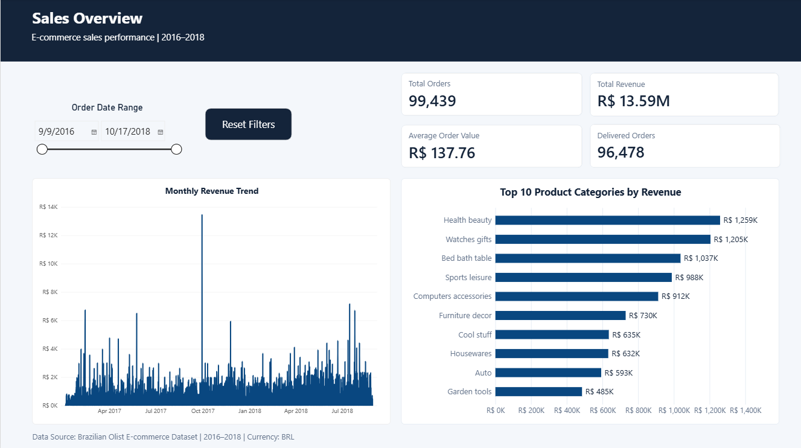
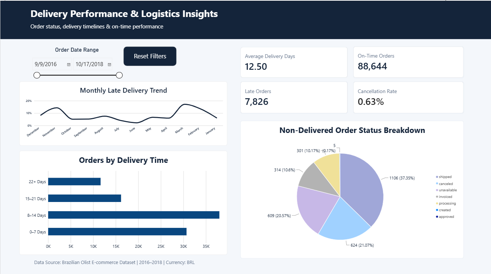
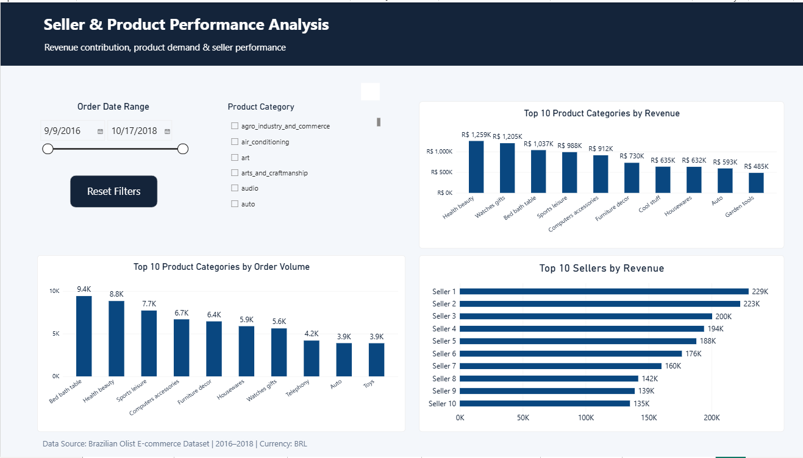
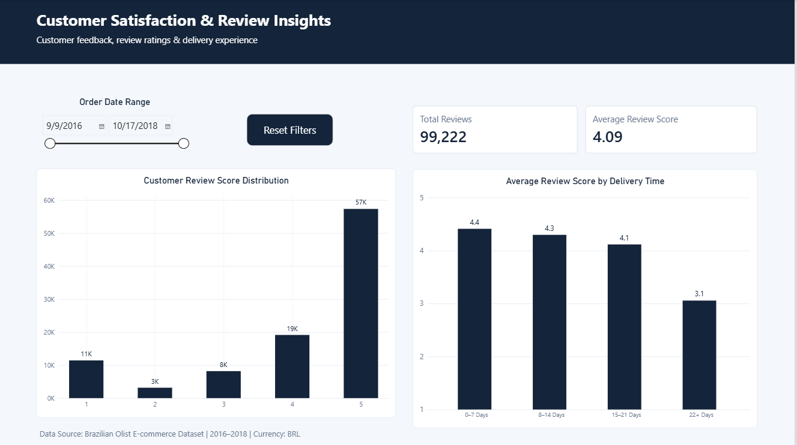

# E-commerce Operations & Delivery Performance Intelligence

## Project Overview

This project analyzes Brazilian e-commerce operations using the Olist E-commerce Dataset (2016–2018). The objective is to transform raw transactional data into meaningful business insights using Python, SQL, Excel, and Power BI.

The analysis focuses on sales performance, delivery efficiency, seller performance, product categories, and customer satisfaction.

An interactive four-page Power BI dashboard was developed to help understand business performance, identify operational issues, and support data-driven decision-making.

## Business Questions Answered

This project addresses the following business questions:

1. How many orders were placed, and what was the total revenue?
2. Which product categories generated the highest revenue?
3. How many orders were successfully delivered, canceled, or in other statuses?
4. What percentage of delivered orders arrived late?
5. Which months experienced the highest late-delivery rates?
6. What was the average delivery time?
7. Which sellers generated the highest revenue?
8. Which product categories received the highest order volume?
9. What was the average customer review score?
10. How does late delivery relate to customer satisfaction?

## Key Findings

| Metric | Result |
|---|---:|
| Total Orders | 99,441 |
| Total Revenue | R$13.59 Million |
| Delivered Orders | 96,478 |
| On-Time Orders | 88,644 |
| Late Orders | 7,826 |
| Late Delivery Rate | 8.11% |
| Average Delivery Time | 12.56 Days |
| Average Review Score | 4.09 / 5 |
| Total Reviews | 99,224 |

**Note:** Revenue represents product-item prices and excludes freight charges. The late-delivery rate is calculated using delivered orders with valid delivery and estimated delivery dates. Eight delivered orders had missing dates and were excluded from the on-time/late classification.

## Power BI Dashboard

The report contains four interactive pages:

### 1. Sales Overview
- Total orders and revenue
- Average order value
- Monthly revenue trends
- Top 10 product categories by revenue

### 2. Delivery Performance & Logistics Insights
- Average delivery days
- On-time and late orders
- Late delivery percentage
- Cancellation rate
- Monthly late-delivery trends
- Order status analysis

### 3. Seller & Product Performance Analysis
- Top 10 product categories by revenue
- Top 10 product categories by order volume
- Top 10 sellers by revenue

### 4. Customer Satisfaction & Review Insights
- Average review score
- Total customer reviews
- Review score distribution
- Average review score by delivery time

- ## Dashboard Preview

### 1. Sales Overview


### 2. Delivery Performance & Logistics Insights


### 3. Seller & Product Performance Analysis


### 4. Customer Satisfaction & Review Insights


## Tools & Technologies

| Tool | Purpose |
|---|---|
| Python | Data profiling and cleaning |
| Pandas | Data manipulation and preprocessing |
| PostgreSQL | Database management and SQL analysis |
| SQL | Business analysis and data exploration |
| Microsoft Excel | Initial data exploration |
| Power BI | Interactive dashboards and visualizations |
| DAX | Measures and calculated columns |
| Power Query | Data transformation |

## Project Structure

```text
Ecommerce-Operations-Intelligence/
│
├── powerbi/
│   └── Ecommerce_Operations_Delivery_Intelligence.pbix
│
├── reports/
│   ├── Ecommerce_Operations_Dashboard.pdf
│   ├── dataset_profile.csv
│   └── missing_values_report.csv
│
├── python/
│   ├── 01_profile_data.py
│   └── 02_clean_data.py
│
├── sql/
│   └── 01_business_analysis.sql
│
├── excel/
│   └── Initial_Data_Exploration.xlsx
│
└── README.md
```

## Methodology

The project followed these major steps:

1. **Data Exploration:** Examined the dataset using Excel to understand its structure and identify initial patterns.
2. **Data Profiling:** Used Python to analyze dataset dimensions, missing values, and data quality.
3. **Data Cleaning:** Processed datasets using Python and Pandas.
4. **Database Management:** Loaded data into PostgreSQL and established relationships between relevant tables.
5. **SQL Analysis:** Performed business-focused queries to calculate key performance metrics.
6. **Data Visualization:** Built an interactive Power BI dashboard using DAX measures, calculated columns, and Power Query transformations.

## Dataset

**Source:** Brazilian E-Commerce Public Dataset by Olist.

The dataset contains information about orders, customers, sellers, products, payments, reviews, and deliveries.

Dataset source: [Olist Brazilian E-Commerce Dataset – Kaggle](https://www.kaggle.com/datasets/olistbr/brazilian-ecommerce)

The original and processed CSV datasets are not included in this repository due to their size. They can be obtained from the original Kaggle source.

## Key Learnings

Through this project, I gained practical experience in:

- Data exploration and data quality assessment.
- Cleaning and preparing datasets using Python.
- Writing SQL queries for business analysis.
- Working with relational databases.
- Developing DAX measures and calculated columns.
- Building interactive Power BI dashboards.
- Translating business questions into meaningful analytical insights.

## Project Deliverables

- Power BI dashboard (`.pbix`)
- Dashboard PDF report
- Python data profiling and cleaning scripts
- PostgreSQL SQL analysis
- Excel initial data exploration
- Dataset profiling and missing-value reports

---

**Project:** E-commerce Operations & Delivery Performance Intelligence  
**Domain:** E-commerce Analytics / Business Intelligence  
**Tools:** Python, PostgreSQL, SQL, Excel, Power BI
